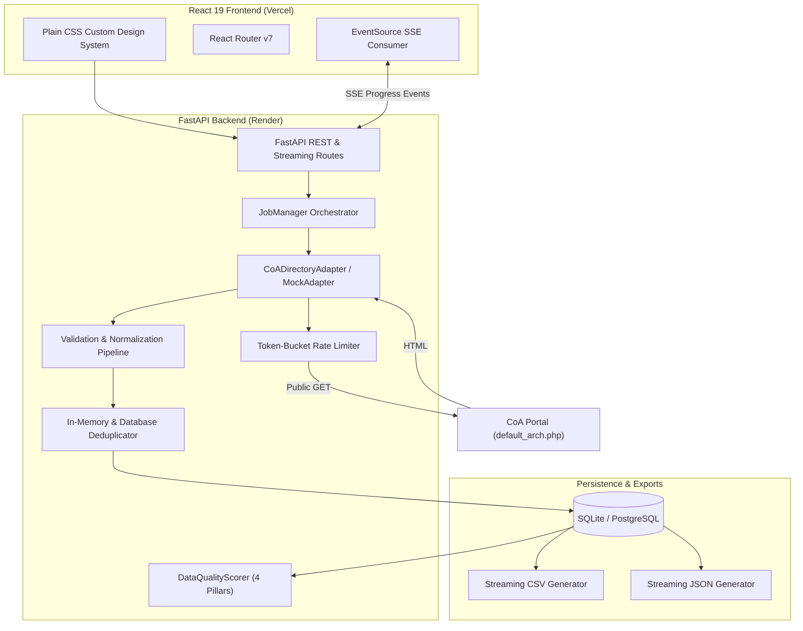

# Council of Architecture Directory Data Extraction & High-Speed Pipeline

A reliable, high-speed data extraction, normalization, and analysis platform for the **public Council of Architecture (CoA) architect directory** in India.

Built with **FastAPI**, **React 19**, **Vite**, **TypeScript**, and a **Strict No-Framework Custom CSS Design System**.

---

## 1. Project Overview

The Council of Architecture (CoA) is a statutory authority established by the Government of India under the Architects Act, 1972, maintaining the statutory Register of Architects.

This platform empowers researchers, architects, and compliance officers to:
- **Extract** directory records with bounded concurrency and respectful rate limiting.
- **Normalize** data, standardize dates, title-case names, and map locations.
- **Deduplicate** records with O(1) in-memory hashing using registration codes as primary keys.
- **Monitor** extraction progress in real-time via Server-Sent Events (SSE).
- **Evaluate** data quality with an auditable 4-pillar quality score (0–100).
- **Export** complete datasets in chunked streaming CSV or JSON formats.
- **Run Offline** with a high-fidelity synthetic mock mode when the government portal is offline or rate-limiting.

---

## 2. Key Features

- **High-Speed Async Extraction**: Bounded concurrency with `asyncio.Semaphore` and connection pooling via `httpx.AsyncClient`.
- **Token-Bucket Rate Limiting**: Request pacing (default 2.0 req/s) with adaptive exponential backoff on HTTP 429 and `Retry-After` header parsing.
- **Strict No-Framework CSS**: 100% custom CSS with a complete design system (`variables.css`, `layout.css`, `components.css`, `forms.css`, `tables.css`, `responsive.css`). **Zero Tailwind, Bootstrap, or Material UI**.
- **Real-Time Live Monitoring**: Server-Sent Events (SSE) push live progress percentages, extraction speed (records/sec), elapsed time, and ETA directly to the browser.
- **Streaming Exports**: Chunked CSV and JSON streaming via SQLAlchemy `yield_per()` keeping memory consumption under 1MB even for large datasets.
- **Transparent Data Quality Scoring**: Evaluates dataset health based on Completeness (40%), Validity (30%), Uniqueness (20%), and Consistency (10%).
- **Dual Mode Support**:
  - `Live Mode`: Directly extracts from `https://www.coa.gov.in/default_arch.php`.
  - `Mock Mode`: Seamless local testing with 255 pre-validated realistic records from `mock_data/architects.json`.

---

## 3. Technology Stack

| Layer | Technologies |
| :--- | :--- |
| **Frontend** | React 19, Vite, TypeScript, React Router v7, Lucide React, Custom CSS |
| **Backend** | Python 3.10+, FastAPI, Pydantic v2, asyncio, httpx, BeautifulSoup4, SQLAlchemy, sse-starlette |
| **Database** | SQLite (Default / Zero-Config) or PostgreSQL (Production) |
| **Testing** | Pytest, pytest-asyncio (Backend: 12 tests) \| Vitest, @testing-library/react (Frontend: 5 tests) |
| **Deployment** | Vercel (Frontend Edge CDN) + Render (Backend Web Service) |

---

## 4. Architecture Overview



---

## 5. Local Setup & Execution

### Prerequisites
- Python 3.10+
- Node.js 18+ and npm

### 1. Clone & Setup Backend
```bash
# Navigate to backend
cd backend

# Install dependencies
pip install -r requirements.txt

# Start FastAPI server
uvicorn app.main:app --reload --host 0.0.0.0 --port 8000
```
Backend API will be live at: `http://localhost:8000`  
Swagger Documentation: `http://localhost:8000/docs`

### 2. Setup & Start Frontend
```bash
# Open a new terminal and navigate to frontend
cd frontend

# Install dependencies
npm install

# Start Vite dev server
npm run dev
```
Frontend Web Application will be live at: `http://localhost:5173`

---

## 6. Environment Variables

Create `.env` based on `.env.example`:

```env
COA_BASE_URL=https://www.coa.gov.in
DATABASE_URL=sqlite:///./coa_directory.db
MAX_CONCURRENCY=5
REQUESTS_PER_SECOND=2.0
REQUEST_TIMEOUT=30
MAX_RETRIES=3
BATCH_SIZE=50
USE_MOCK_DATA=false
CORS_ORIGINS=http://localhost:5173,http://localhost:3000
```

Frontend Environment Variable (`frontend/.env`):
```env
VITE_API_BASE_URL=http://localhost:8000
```

---

## 7. Testing & Verification

### Running Backend Tests
```bash
python -m pytest backend/tests -v
```
*Results: 12 tests passed (validation, normalization, rate limiter, deduplicator, adapters, health, endpoints).*

### Running Frontend Tests
```bash
cd frontend
npx vitest run
```
*Results: 5 component unit tests passed.*

### Building Frontend for Production
```bash
cd frontend
npm run build
```
*Results: Vite production bundle built in < 1 second.*

### Running Performance Benchmarks
```bash
python scripts/benchmark.py
```
*Results: 3,205 records/sec throughput with 0.75 MB peak memory usage.*

---

## 8. Deployment Guides

### Frontend &rarr; Vercel
1. Import repository in [Vercel](https://vercel.com).
2. Set Root Directory to `frontend`.
3. Set Framework to `Vite`.
4. Add Environment Variable: `VITE_API_BASE_URL=https://<your-render-url>.onrender.com`.
5. Deploy. `vercel.json` automatically manages client-side SPA routing.

### Backend &rarr; Render
1. Create a **New Web Service** on [Render](https://render.com).
2. Set Root Directory to `backend`.
3. Build Command: `pip install -r requirements.txt`.
4. Start Command: `uvicorn app.main:app --host 0.0.0.0 --port $PORT`.
5. Add Environment Variables (see `.env.example`).
6. Deploy. Render blueprint specification is also available in `render.yaml`.

---

## 9. Responsible Use & Limitations

- **Statutory Public Directory**: The Council of Architecture portal provides public architect records for verification purposes.
- **Bounded Requests**: The system enforces rate-limiting and bounded concurrency to prevent load on target infrastructure.
- **CAPTCHA & Quota Notice**: Searches on `search_arch2.php` have an IP quota of 3 searches/day. The extraction engine uses the public paginated register `default_arch.php` which is openly accessible.
- **Mock Mode**: Use mock mode (`mode: "mock"`) for development, continuous integration, and UI testing.

---

## 10. License
Educational and research use under the MIT License.
