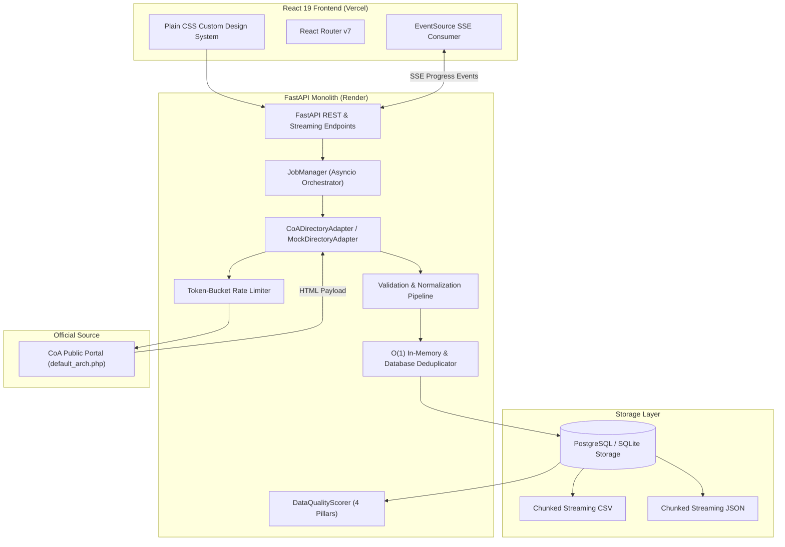

# System Architecture

## Overview
The Council of Architecture (CoA) Directory Data Extraction & High-Speed Pipeline is a production-grade, asynchronous web harvesting, normalization, and analytics platform. It is engineered to process public records from the Council of Architecture statutory registry (`coa.gov.in`) with bounded concurrency, adaptive rate limiting, duplicate detection, and streaming exports.

## Key Architectural Decisions

1. **Modular Monolith for Zero-Cost Deployment**:
   - Single FastAPI backend service eliminates the operational overhead and memory consumption of microservices, Kafka, or external Redis queues.
   - Built to run seamlessly within free-tier compute boundaries (e.g. Render 512MB RAM, Vercel Serverless).

2. **Adaptive Token-Bucket Rate Limiter**:
   - Strictly enforces requests-per-second constraints (`REQUESTS_PER_SECOND=2.0`).
   - Dynamically backs off upon encountering HTTP 429 status codes and honors `Retry-After` headers.

3. **In-Flight Deduplication**:
   - Registration numbers (`CA/YYYY/NNNNN`) serve as primary unique keys.
   - Composite keys `(normalized_name, city)` prevent corrupt or re-issued entry collision.

4. **Zero-Memory Streaming Exports**:
   - Database queries use SQLAlchemy's `yield_per()` to stream CSV and JSON directly to the client without buffering entire datasets in memory.
