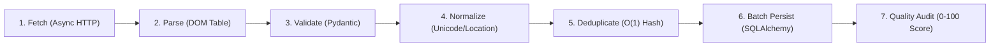

# Extraction & Data Engineering Pipeline

## Pipeline Lifecycle

The data pipeline processes architect records through seven sequential stages designed for data integrity, low latency, and memory safety:

### Stage 1: Async Network Fetching
- Uses persistent connection pooling via `httpx.AsyncClient`.
- Managed by `asyncio.Semaphore(concurrency)` with token bucket rate limiting.
- Automatic exponential backoff retry on transient HTTP 5xx or timeout errors.

### Stage 2: HTML Parsing
- BeautifulSoup4 parses the HTML table in `default_arch.php`.
- Extracts: Serial Number, Architect Name, Registration Number, City, Validity Date.

### Stage 3: Strict Schema Validation
- Pydantic models validate that:
  - `name` is non-empty and contains at least 2 characters.
  - `registration_number` conforms to CoA regex: `^CA\/\d{4}\/\d{1,6}$`.
- Invalid records are flagged and logged to `extraction_errors` table with exact failure reasons.

### Stage 4: Data Normalization
- Unicode normalization (NFKC) collapses non-breaking spaces (`\xa0`) and redundant whitespace.
- Honorifics (`Ar.`, `Mr.`, `Ms.`, `Dr.`) are parsed and title-cased.
- City names are mapped against Indian geographical tables to infer correct State / Union Territory.
- Registration year is derived from registration code or validity string.

### Stage 5: In-Memory Deduplication
- Primary hash check against registered CoA numbers.
- Secondary composite check against `(normalized_name, city)`.
- Prevents database duplicate primary key violations and tracks duplicate ratios.

### Stage 6: Batch Storage & Memory Release
- Records are flushed in batches (50 records per page) using SQLAlchemy `bulk_save_objects()`.
- Avoids accumulating unbounded Python lists in memory.

### Stage 7: Algorithmic Data Quality Scoring
Computes an auditable score (0–100) based on 4 weighted pillars:
- **40% Completeness**: Ratio of non-null core fields (Name, RegNo, City, State, Validity, Year).
- **30% Validity**: Compliance with standard registration code and date formats.
- **20% Uniqueness**: Absence of duplicate records.
- **10% Consistency**: Chronological and geographical alignment.
